# Gestion de parc et helpdesk avec GLPI 12 (Debian · GLPI Agent · TeamViewer)


Ce projet met en place un serveur **GLPI 12** sur **Debian 13** qui recense automatiquement les postes Windows du réseau grâce à **GLPI Agent**, et qui sert de **helpdesk** pour les demandes des utilisateurs. La prise en main à distance passe par **TeamViewer**. Il a été réalisé dans le cadre du module RESE340 (*Suivi et résolution d'incidents : les outils*) du **BTS SIO option SISR** à l'EPSI Montpellier.

Les postes envoient eux-mêmes leur configuration (système, matériel, logiciels) au serveur. Quand un utilisateur ouvre un ticket, le technicien a déjà la fiche de son poste sous les yeux avant même de prendre la main dessus.

<p align="center">
  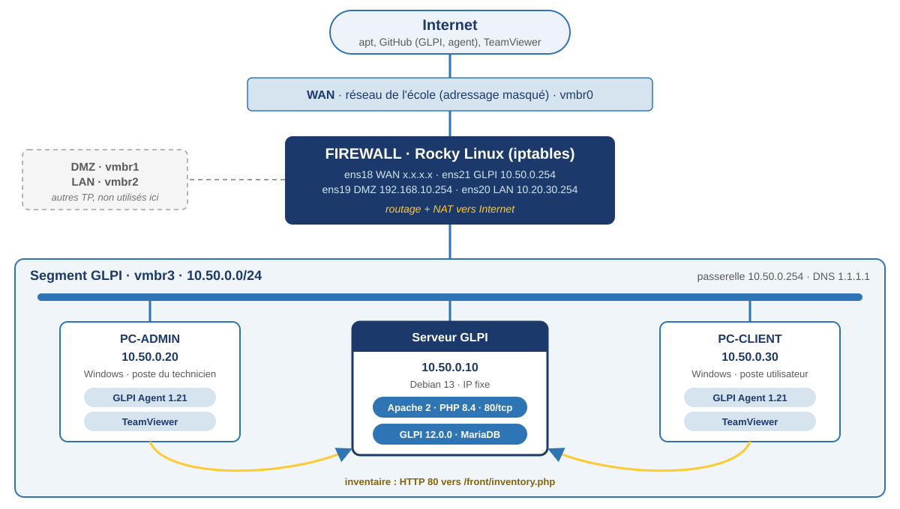
</p>

---

## Sommaire

- [Contexte et objectifs](#contexte-et-objectifs)
- [Architecture](#architecture)
- [Fonctionnement](#fonctionnement)
- [Choix techniques](#choix-techniques)
- [Contenu du dépôt](#contenu-du-dépôt)
- [Déploiement](#déploiement)
- [Tests et résultats](#tests-et-résultats)
- [Problèmes rencontrés](#problèmes-rencontrés)
- [Pistes d'amélioration](#pistes-damélioration)

---

## Contexte et objectifs

Sans outil de support, un technicien qui reçoit un appel ne sait rien du poste concerné : ni le système, ni les logiciels installés, ni ce qui a déjà été tenté. Une fois le problème réglé, il ne reste aucune trace de l'intervention, et il faut souvent se déplacer pour agir sur la machine.

Le projet répond à quatre objectifs :

| # | Objectif | Réponse apportée |
|---|---|---|
| 1 | Connaître le parc sans saisie manuelle | **GLPI Agent 1.21** sur chaque poste Windows, inventaire **natif** de GLPI |
| 2 | Faire passer chaque demande par un ticket | Module **Assistance** de GLPI, ticket rattaché au poste concerné |
| 3 | Intervenir sur un poste sans se déplacer | **TeamViewer** sur le poste du technicien et sur celui de l'utilisateur |
| 4 | Isoler le labo du reste du réseau | Segment dédié **vmbr3** derrière le firewall, sortie Internet par **NAT** |

---

## Architecture

Tout tourne sur un hyperviseur **Proxmox VE**. Le labo GLPI a son propre bridge, `vmbr3` (commentaire *LAN_GLPI*), raccordé à la 4ᵉ carte du firewall déjà utilisé pour les autres TP (DMZ, LAN). C'est un bridge **interne** : aucun port physique et aucune IP côté hôte, seules les VM branchées dessus se voient. Le firewall route et filtre le trafic entre ce segment et Internet.

<p align="center">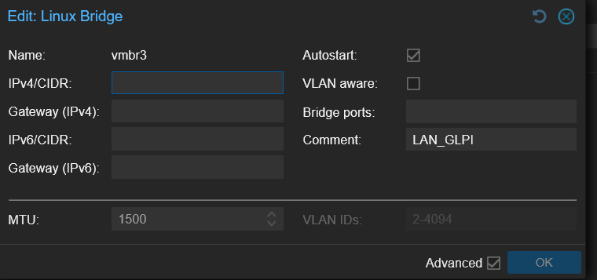</p>

| Machine | OS | Adresse | Réseau | Rôle |
|---|---|---|---|---|
| Firewall | Rocky Linux | `10.50.0.254` côté GLPI (`ens21`) | WAN / DMZ / LAN / vmbr3 | Passerelle, NAT, filtrage iptables |
| Serveur GLPI | Debian 13 | `10.50.0.10` (fixe) | vmbr3 | Apache 2, PHP 8.4, MariaDB, GLPI 12.0.0 |
| PC-ADMIN | Windows | `10.50.0.20` (fixe) | vmbr3 | Poste du technicien : navigateur, GLPI Agent, TeamViewer |
| PC-CLIENT | Windows | `10.50.0.30` (fixe) | vmbr3 | Poste de l'utilisateur : GLPI Agent, TeamViewer |

Plan d'adressage du segment (`10.50.0.0/24`) :

| Adresse | Usage |
|---|---|
| `.10` | Serveur GLPI |
| `.20` – `.30` | Postes Windows (admin, client) |
| `.254` | Passerelle (firewall, `ens21`) |
| DNS | `1.1.1.1` |

Table de routage du firewall une fois tout en place : une route par patte, et la route par défaut qui sort par le WAN.

```
[root@Firewall ~]# ip route
default via x.x.x.x dev ens18 proto dhcp src x.x.x.x metric 107
10.20.30.0/24 dev ens20 proto kernel scope link src 10.20.30.254 metric 106
10.50.0.0/24 dev ens21 proto kernel scope link src 10.50.0.254 metric 104
192.168.10.0/24 dev ens19 proto kernel scope link src 192.168.10.254 metric 101
x.x.x.0/24 dev ens18 proto kernel scope link src x.x.x.x metric 107
```

> L'adressage du réseau de l'école (WAN) est volontairement masqué. Les autres adresses sont celles d'un labo isolé (RFC 1918).

---

## Fonctionnement

### Inventaire : l'agent parle à GLPI

<p align="center">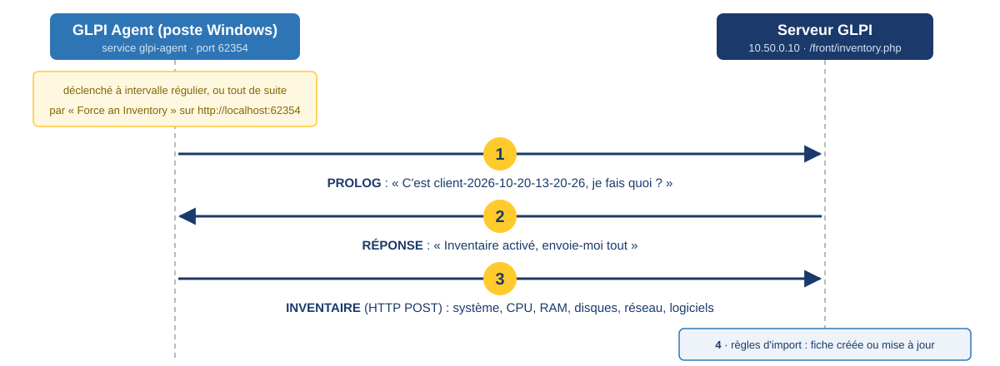</p>

1. **PROLOG** : l'agent se présente avec son identifiant (`client-2026-10-20-13-20-26`) et demande au serveur ce qu'il doit faire.
2. **Réponse** : GLPI vérifie que l'inventaire est activé et lui demande d'envoyer ses données.
3. **Inventaire** : l'agent collecte les informations du poste (WMI, registre) et les envoie en HTTP POST sur `/front/inventory.php`.
4. **Import** : GLPI applique ses règles d'import. Si le poste existe déjà (même UUID ou même nom), sa fiche est mise à jour, sinon elle est créée.

Par défaut, **GLPI 12 refuse les inventaires** : il faut cocher *Activer l'inventaire* dans *Administration > Inventaire*. Sans ce réglage, l'agent échoue dès l'étape 1.

L'agent envoie son inventaire à intervalle régulier. Pour ne pas attendre, la page `http://localhost:62354` du poste propose un lien **Force an Inventory** : le poste apparaît alors immédiatement dans *Parc > Ordinateurs*.

### Helpdesk et télé-assistance

1. L'utilisateur ouvre un ticket depuis son interface GLPI.
2. Le technicien le prend en charge et ouvre la fiche du poste rattaché : système, mémoire, logiciels, tout vient de l'inventaire.
3. Si le problème ne se règle pas par téléphone, il lance **TeamViewer** sur PC-ADMIN. L'utilisateur lui donne l'identifiant et le mot de passe affichés sur son écran, puis accepte la connexion.
4. Le technicien corrige le problème, note ce qu'il a fait dans le ticket et propose la solution.
5. L'utilisateur valide la solution, le ticket est clos.

TeamViewer n'a besoin d'**aucun port entrant** : les deux postes se connectent en sortie aux serveurs de l'éditeur (443/tcp), ce que le firewall autorise déjà.

---

## Choix techniques

| Choix | Justification |
|---|---|
| **GLPI** plutôt qu'OCS Inventory ou Snipe-IT | Seul outil libre qui réunit l'inventaire automatique et un helpdesk orienté ITIL. L'inventaire est natif depuis GLPI 10 : plus besoin du plugin FusionInventory. |
| **Debian 13** plutôt que 12 | GLPI 12 exige **PHP 8.3 à 8.5**. Debian 12 ne fournit que PHP 8.2, Debian 13 fournit PHP 8.4. |
| Racine web sur **`/public`** | Imposé depuis GLPI 11 : sinon GLPI n'affiche qu'une page *« The web server seems to be misconfigured »*. Les URL n'ont donc pas de `/glpi` devant. |
| Base et compte **MariaDB dédiés** | GLPI ne se connecte jamais en root, son compte n'a des droits que sur la base `glpi`. |
| **GLPI Agent** plutôt que l'agent FusionInventory | C'est l'agent officiel, qui parle le protocole d'inventaire natif de GLPI. Un seul `.msi` pour tous les postes. |
| Config, données et journaux **hors du dossier web** | `/etc/glpi`, `/var/lib/glpi/files` et `/var/log/glpi` au lieu de `config/` et `files/` dans `/var/www`. Les fichiers sensibles (connexion à la base, documents joints) ne sont jamais servis par Apache, et une mise à jour de GLPI ne touche pas aux données. |
| **IP fixe** pour le serveur | C'est l'adresse que tous les agents contactent : si elle change, plus rien ne remonte. |
| **Segment dédié** `vmbr3` | Réutilise le firewall des TP précédents (routage + NAT) et isole le labo des autres zones. |
| **TeamViewer** | Connexion sortante uniquement, rien à ouvrir en entrée, prise en main immédiate pour l'utilisateur. |

---

## Contenu du dépôt

```
.
├── configs/
│   ├── reseau/interfaces                    # IP fixe du serveur (ens18, passerelle .254)
│   ├── reseau/resolv.conf                   # DNS du serveur
│   ├── apache/glpi.conf                     # VirtualHost GLPI 12 (racine sur /public)
│   ├── proxmox/vmbr3.interfaces             # bridge interne du labo sur l'hôte
│   ├── mariadb/creation-base.sql            # base glpi + compte glpi_adm
│   ├── glpi/downstream.php                  # config de GLPI déplacée dans /etc/glpi
│   ├── glpi/local_define.php                # données et journaux hors du dossier web
│   ├── firewall/segment-glpi.sh             # routage, règles FORWARD et NAT du segment
│   ├── firewall/correction-profil-wan.md    # dépannage NetworkManager sur le WAN
│   ├── glpi-agent/installer-agent.ps1       # installation silencieuse de l'agent
│   └── glpi-agent/corriger-url-serveur.ps1  # correction de l'URL dans le registre
├── scripts/
│   ├── verif-serveur.sh                     # contrôle réseau, Apache, PHP, MariaDB, GLPI, parc
│   └── verif-agent.ps1                      # contrôle de l'agent sur un poste Windows
└── docs/
    ├── architecture.svg                     # schéma de l'infra
    ├── inventaire.svg                       # échange agent <-> serveur
    └── captures/                            # captures des problèmes et des tests
```

---

## Déploiement

### Hôte Proxmox

Créer le bridge `vmbr3` sans port physique ni IP (*Système > Réseau > Créer > Linux Bridge*), voir [vmbr3.interfaces](configs/proxmox/vmbr3.interfaces). Y brancher la 4ᵉ carte du firewall, le serveur GLPI et les deux postes Windows.

### Firewall (Rocky Linux)

```bash
bash configs/firewall/segment-glpi.sh
```

Si le serveur GLPI reçoit `Destination Net Unreachable` en pingant Internet, voir [correction-profil-wan.md](configs/firewall/correction-profil-wan.md).

### Serveur GLPI (Debian 13, en root)

```bash
# 1. Réseau
cp configs/reseau/interfaces /etc/network/interfaces
cp configs/reseau/resolv.conf /etc/resolv.conf
systemctl restart networking

# 2. Paquets (php = PHP 8.4 sur Debian 13)
apt update && apt upgrade -y
apt install -y apache2 mariadb-server php libapache2-mod-php \
  php-mysql php-curl php-gd php-intl php-mbstring php-xml php-zip \
  php-bz2 php-ldap php-apcu php-bcmath
systemctl enable --now apache2 mariadb

# 3. Base de données (changer le mot de passe dans le script avant)
mysql_secure_installation
mysql < configs/mariadb/creation-base.sql
mysql -u glpi_adm -p glpi -e "SELECT 1"     # le compte doit marcher AVANT l'assistant

# 4. GLPI
wget https://github.com/glpi-project/glpi/releases/download/12.0.0/glpi-12.0.0.tgz
tar -xzf glpi-12.0.0.tgz -C /var/www/html/

# 5. Config, données et journaux hors du dossier web
mkdir -p /var/lib/glpi /var/log/glpi
mv /var/www/html/glpi/config /etc/glpi
mv /var/www/html/glpi/files /var/lib/glpi/
cp configs/glpi/downstream.php /var/www/html/glpi/inc/downstream.php
cp configs/glpi/local_define.php /etc/glpi/local_define.php
php -l /etc/glpi/local_define.php           # "No syntax errors detected"
chown -R www-data:www-data /var/www/html/glpi /etc/glpi /var/lib/glpi /var/log/glpi

# 6. Apache
cp configs/apache/glpi.conf /etc/apache2/sites-available/
a2enmod rewrite
a2ensite glpi.conf && a2dissite 000-default.conf
apache2ctl configtest && systemctl reload apache2
```

Ensuite, depuis le navigateur de PC-ADMIN, `http://10.50.0.10` lance l'assistant : langue, contrôle des prérequis, connexion à la base avec le compte `glpi_adm`, création des tables. Après l'installation :

1. Changer le mot de passe des comptes par défaut (`glpi`, `tech`, `normal`, `post-only`).
2. Supprimer le script d'installation : `rm /var/www/html/glpi/install/install.php`.
3. Activer l'inventaire : *Administration > Inventaire > Activer l'inventaire*.
4. Vérifier : `bash scripts/verif-serveur.sh`.

### Postes Windows (PC-ADMIN et PC-CLIENT)

1. Télécharger `GLPI-Agent-1.21-x64.msi` sur [la page des versions du projet](https://github.com/glpi-project/glpi-agent/releases).
2. Lancer l'installateur en administrateur. À l'écran **Choose Targets**, laisser *Local Target* vide, mettre `http://10.50.0.10/front/inventory.php` dans **Remote Targets** et garder **Quick installation** cochée.
   *Ou en une commande :* `powershell -ExecutionPolicy Bypass -File configs\glpi-agent\installer-agent.ps1`

   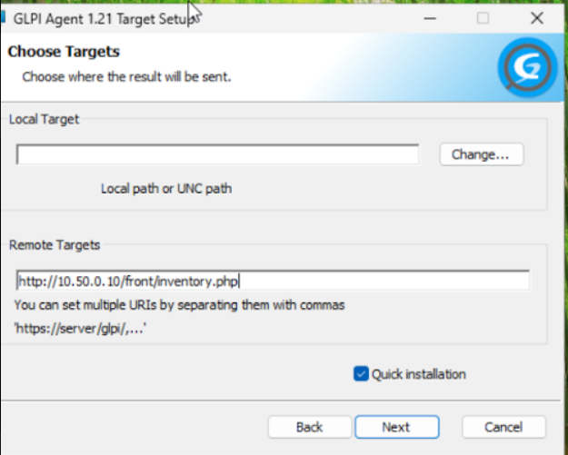

3. Ouvrir `http://localhost:62354` et cliquer sur **Force an Inventory**.
4. Vérifier : `powershell -ExecutionPolicy Bypass -File scripts\verif-agent.ps1`.
5. Installer TeamViewer. Sur PC-CLIENT, garder un mot de passe aléatoire par session et laisser l'accès sans surveillance désactivé : personne ne peut se connecter sans l'accord de l'utilisateur.

---

## Tests et résultats

| Test | Commande / emplacement | Résultat |
|---|---|---|
| Sortie Internet du serveur | `ping -c 3 1.1.1.1` | Réponses, après correction du profil WAN du firewall |
| Interface web | `http://10.50.0.10` depuis PC-ADMIN | Page de connexion GLPI |
| URL d'inventaire | `curl.exe -I http://10.50.0.10/front/inventory.php` | Le serveur répond, plus de `404` |
| Agent démarré | `http://localhost:62354` sur chaque poste | Page de l'agent avec le lien *Force an Inventory* |
| Envoi de l'inventaire | `C:\Program Files\GLPI-Agent\logs\glpi-agent.log` | `New inventory from client-2026-10-20-13-20-26 for server0` |
| Parc | *Parc > Ordinateurs* dans GLPI | PC-CLIENT et PC-ADMIN présents, avec leurs composants et logiciels |

<p align="center"></p>

---

## Problèmes rencontrés

| Symptôme | Cause | Solution |
|---|---|---|
| `ping 1.1.1.1` depuis le serveur : `From 10.50.0.254 Destination Net Unreachable` | Profil NetworkManager du WAN mal configuré sur le firewall : `ens18` portait l'adresse du LAN (`10.20.30.254`) au lieu de son IP DHCP, et le profil interdisait la route par défaut (`never-default`) | Profil `WAN` remis en DHCP sur `ens18` avec la route par défaut autorisée ([détail](configs/firewall/correction-profil-wan.md)) |
| Étape 2 de l'assistant : *« Access denied for user 'glpi_adm'@'localhost' »* | Le compte et le mot de passe saisis dans l'assistant ne correspondaient pas à ceux créés dans MariaDB | Compte testé en ligne de commande (`mysql -u glpi_adm -p`), mot de passe redéfini avec `ALTER USER` |
| Parc vide après l'installation de l'agent | Installation en mode *Typical* : l'adresse du serveur n'est jamais demandée | Adresse saisie dans *Remote Targets* (ou dans le registre) |
| Relance de l'installateur : *« Only administrators can modify GLPI Agent installation »* | Installateur lancé sans droits administrateur | Adresse écrite directement dans `HKLM:\SOFTWARE\GLPI-Agent` depuis un PowerShell admin |
| `404 Not Found` dans `glpi-agent.log` | URL en `/glpi/front/inventory.php`, alors que la racine web est le dossier `/public` | `http://10.50.0.10/front/inventory.php` |
| PowerShell bloqué sur `>>` | Guillemet de fin oublié dans la commande | `Ctrl + C`, commande retapée sur une seule ligne puis vérifiée |
| PROLOG refusé par GLPI | Inventaire et import de nouveaux postes non autorisés côté GLPI | Inventaire activé et restriction levée dans *Administration > Inventaire* |

<details>
<summary><b>Voir les captures des problèmes</b></summary>

**1. Pas d'Internet depuis le serveur GLPI** : la réponse vient de la passerelle elle-même.

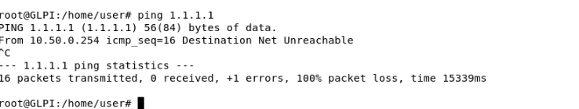

Sur le firewall, `ens18` (WAN) porte l'adresse du LAN, et le profil `WAN` se retrouve en double :

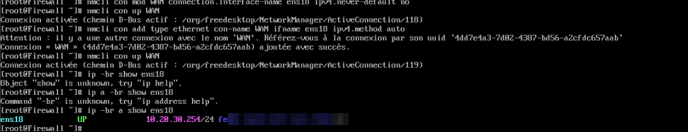

**2. Accès refusé à la base** pendant l'assistant d'installation :

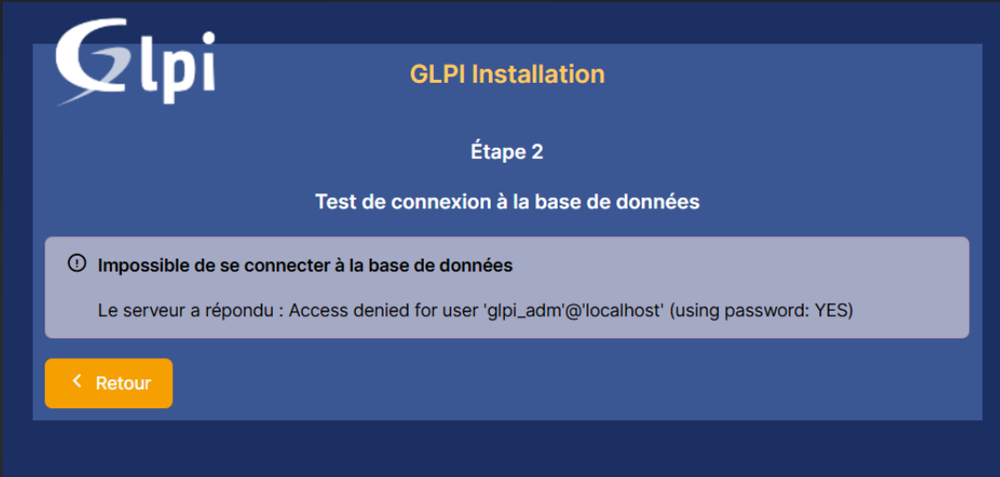

**3. Parc vide** après une installation de l'agent en mode *Typical* :

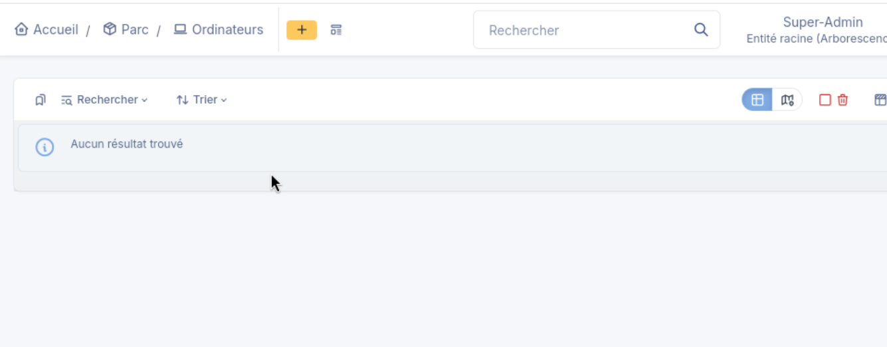 Ordinateurs : Aucun résultat trouvé" width="700">

**4. Installateur relancé sans droits administrateur :**

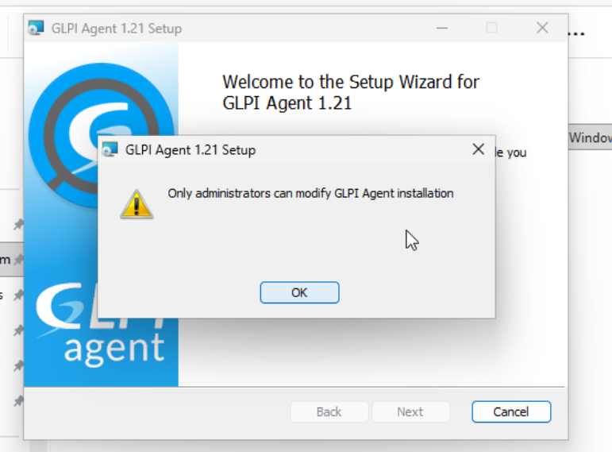

**5. URL avec `/glpi` en trop** : le serveur répond, mais en 404.

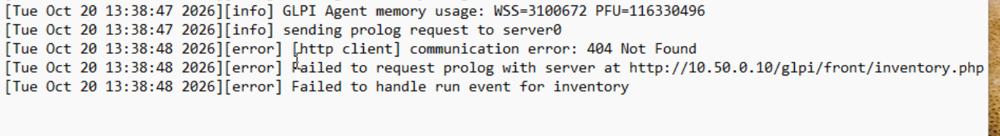

**6. PowerShell bloqué sur `>>`** : le guillemet de fin manque après `inventory.php`.

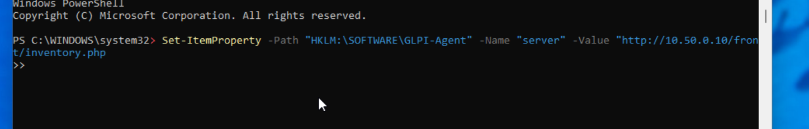>" width="900">

**7. Bonne URL, mais PROLOG refusé** tant que l'inventaire n'est pas autorisé côté GLPI :

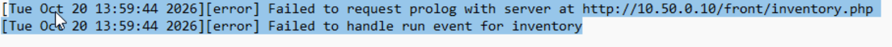

</details>

Méthode de diagnostic utilisée : un **404** veut dire que le serveur répond et que seul le chemin est faux ; un **Net Unreachable renvoyé par la passerelle** veut dire que le paquet arrive au routeur mais que celui-ci n'a pas de route pour aller plus loin. Dans tous les cas, on lit d'abord le journal (`glpi-agent.log`, `journalctl`, logs Apache) avant de toucher à la configuration.

---

## Pistes d'amélioration

Le TP s'arrête ici. Voici ce qu'il faudrait ajouter pour passer en production :

- **HTTPS** avec un certificat : pour l'instant, mots de passe et inventaires circulent en clair.
- **Authentifier les agents** au lieu de laisser n'importe quelle machine du segment créer une fiche.
- **Organisation du support** : groupes *Support N1 / N2*, catégories de tickets, **SLA** par priorité et règle métier qui envoie directement les tickets *Sécurité* au N2.
- **Lier TeamViewer à la fiche du poste** (onglet *Gestion à distance*) pour lancer la session en un clic depuis le ticket.
- **Licence TeamViewer** (la version gratuite est réservée à l'usage personnel) ou passage à **RustDesk** auto-hébergé.
- **Active Directory** : déploiement de l'agent par GPO et connexion à GLPI avec le compte Windows.
- **Collecteur de mails** pour qu'un simple mail au support crée un ticket, et supervision (**Zabbix**) qui ouvre un ticket quand un service tombe.
- **Sauvegarde** planifiée de la base (`mysqldump`) et du dossier `files/` de GLPI.

---

## Auteur

**Charly Izorce** · BTS SIO option SISR · EPSI Montpellier · 2026
