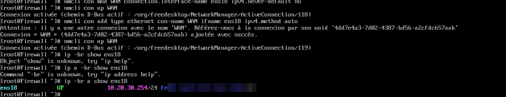

# Correction du profil NetworkManager sur le WAN du firewall

## Symptôme

Depuis le serveur GLPI :

```
root@GLPI:~# ping 1.1.1.1
From 10.50.0.254 icmp_seq=16 Destination Net Unreachable
```

La réponse vient de la passerelle elle-même (`10.50.0.254`, le firewall). Le paquet arrive donc bien jusqu'au firewall, mais celui-ci ne sait pas où l'envoyer ensuite : il n'a pas de route par défaut.

## Ce qu'on a trouvé sur le firewall



- `ip -br a show ens18` montre que la carte WAN porte **`10.20.30.254/24`**, l'adresse de la patte LAN, au lieu de l'IP que le DHCP de l'école doit lui donner.
- Le profil `WAN` avait l'option `ipv4.never-default` activée : même avec une IP, il n'aurait jamais créé de route par défaut.
- En recréant le profil avec `nmcli con add`, NetworkManager prévient qu'**un autre profil s'appelle déjà `WAN`**. On se retrouve avec deux profils du même nom, et `nmcli con up WAN` ne sait plus lequel activer.

## Procédure propre

```bash
# 1. Lister les profils et repérer les doublons
nmcli -f NAME,UUID,DEVICE,ACTIVE con show

# 2. Supprimer le profil WAN en trop (par son UUID, pas par son nom)
nmcli con delete <UUID_du_doublon>

# 3. Rattacher le profil WAN à ens18, en DHCP, avec la route par défaut autorisée
nmcli con mod WAN connection.interface-name ens18 ipv4.method auto ipv4.never-default no
nmcli con up WAN

# 4. Si 10.20.30.254 reste sur ens18, c'est que le profil du LAN vise la mauvaise carte :
#    nmcli con mod <profil_LAN> connection.interface-name ens20 && nmcli con up <profil_LAN>

# 5. Vérifier
ip -br a show ens18          # l'IP DHCP de l'école, plus 10.20.30.254
ip route | grep default      # default via <passerelle de l'école> dev ens18 proto dhcp
sysctl net.ipv4.ip_forward   # doit valoir 1
```

## Résultat

```
[root@Firewall ~]# ip route
default via x.x.x.x dev ens18 proto dhcp src x.x.x.x metric 107
10.20.30.0/24 dev ens20 proto kernel scope link src 10.20.30.254 metric 106
10.50.0.0/24 dev ens21 proto kernel scope link src 10.50.0.254 metric 104
192.168.10.0/24 dev ens19 proto kernel scope link src 192.168.10.254 metric 101
x.x.x.0/24 dev ens18 proto kernel scope link src x.x.x.x metric 107
```

Chaque patte a retrouvé son réseau, et la route par défaut sort bien par `ens18`. Depuis le serveur GLPI, `ping -c 3 1.1.1.1` répond.
